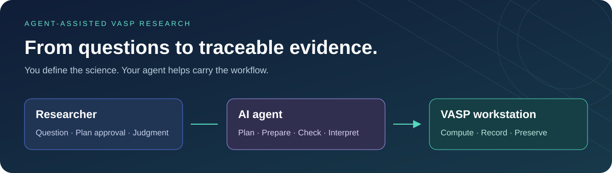
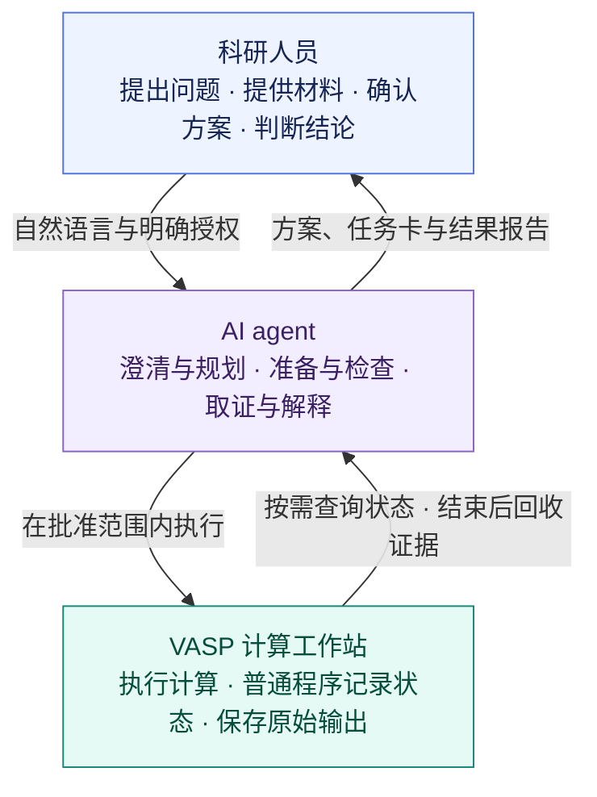

# DFT Workflow Skill

**使用 AI agent 开展 VASP DFT 模拟计算的工作流，现在以 `vasp-dft-workflow` skill 提供。**

**当前标准范围：静态计算、原子参照及固定胞 fresh/warm 弛豫；无外场、无 SOC。** 其他方法需先讨论支持边界和新增验证。

[看一次自然语言协作示意](docs/walkthrough.md)。

提出研究问题、提供材料并确认科学方案；agent 负责按需选择工具、处理命令与记录，并将结论连回实际证据。

安装：请从 [GitHub](https://github.com/kardson/dft-workflow-skill) 安装 `vasp-dft-workflow` skill。

使用：直接告诉 agent：“帮我比较两种结构的稳定性，先核对环境和材料，再讨论计算方案。”

首次可请 agent：“把这个研究项目接入 vasp-dft-workflow，今后 VASP 相关任务默认使用它。”接入后无需每次指定技能名。

协作方式可选 **单 agent / 按需 subagent / 固定双线程**，首次选择后沿用。[选择协作方式](docs/collaboration_modes.md)。

详细安装方式见[skill 安装说明](docs/skill_installation.md)。

[开始使用 →](docs/getting_started.md) · [探索能力 →](docs/capabilities.md) · [Agent 协作指引 →](AGENTS.md)

## 从研究问题到科学判断

**基本顺序：环境就绪 → 明确研究问题 → 确认计算方案 → 准备与检查 → 执行与取证 → 分析与科学判断。**

## 六项核心能力

| 能力 | Agent 帮你做什么 | 你得到什么 |
|---|---|---|
| **环境核验 · Environment Check** | 检查完整依赖、编译功能、资源和运行条件 | 可用性证据与缺项清单 |
| **问题与材料梳理 · Research Intake** | 逐项提问、整理结构和文献需求、协助检索 | 明确的研究问题与材料清单 |
| **计算方案规划 · Calculation Planning** | 整理模型、方法、精度、依赖、代价和停止条件 | 可讨论、可确认的计算方案 |
| **输入准备与审计 · Input Preparation** | 准备候选包，核对实际输入与批准要求 | 有来源、有检查记录的输入包 |
| **执行与证据回收 · Execution & Recovery** | 在批准范围内执行，核验启动、按需查询、终态回收 | 启动回执、状态记录和原始证据 |
| **结果分析与解释 · Result Analysis** | 检查输出与收敛，解析数据，区分事实、解释和限制 | 可追溯的结果报告与科学审阅材料 |

贯穿全程：**简明任务卡**记录当前进展，**批准一致性检查**连接方案、输入与输出要求，**证据来源检查**支持结果复核。名称与实际工具的对应关系见[能力目录](docs/capabilities.md)。

## 三方协作，各有分工

计算启动并确认正常推进后，agent 交付启动情况、结束本轮。长时间计算由工作站记录状态；用户查询或明确安排的定时检查触发后续处理。[查看运行与交付节奏 →](docs/capabilities.md#运行与交付节奏)

## 开始你的第一个研究任务

1. **准备环境** — 具备合法的 VASP 与赝势、计算资源、可调用工具的 agent，以及独立私有研究工作区；请 agent 核对完整环境。
2. **说清问题** — 提供目标和已有材料，与 agent 补齐尚未明确的内容。
3. **确认方案** — 讨论依据、成本和接受条件，再由 agent 按批准范围推进。

[完整使用指南](docs/getting_started.md)包含环境要求、自然语言请求示例、任务卡说明和结果状态解释。

## 按需阅读

| 你想了解什么 | 从这里进入 |
|---|---|
| 怎么让 agent 协助开展研究 | [使用指南](docs/getting_started.md) |
| 各项能力、工具入口与交付物 | [能力目录](docs/capabilities.md) |
| 六步具体规则与记录要求 | [标准流程](docs/standard_workflow.md) |
| 私有数据如何组织 | [私有工作区](docs/private_workspace.md) |
| 环境依赖与验证版本 | [环境复现](docs/reproduce-clean-science.md) · [第三方说明](THIRD_PARTY.md) |
| 如何协作与贡献 | [Agent 指引](AGENTS.md) · [贡献与公开内容要求](docs/publication_policy.md) |

当前标准计算类型包括静态计算、原子参照及固定胞 fresh/warm 弛豫，范围与工具边界见[标准流程](docs/standard_workflow.md)。实际运行需要自己的 VASP 部署与启动适配；科学接受需要研究者结合证据判断。验证覆盖与限制见[使用指南](docs/getting_started.md#验证贡献与许可)。

**许可：本仓库尚未指定许可证。** 使用与再分发前请向维护者确认授权；第三方软件遵守各自许可。
