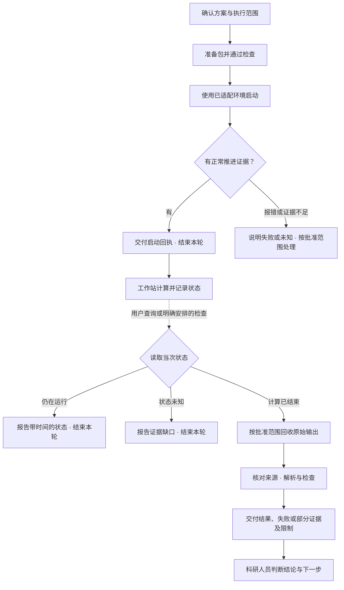

# 能力目录

[返回首页](../README.md) · [使用指南](getting_started.md) · [标准流程](standard_workflow.md)

以下名称是本仓库各项能力的统一展示名称，不代表独立安装的软件或额外的命令。工具入口由 agent 根据实际环境调用。

## 可选协作方式

同一套能力支持单 agent、按需 subagent 和固定双线程。模式改变任务分配与交接方式，科学流程、批准要求和证据标准保持一致。首次接入选择后沿用；支持范围取决于宿主。见[协作模式说明](collaboration_modes.md)。

## 六项核心能力与子能力

| 核心能力 | 子能力名称与职责 | 主要入口 | 交付物 |
|---|---|---|---|
| **环境核验 · Environment Check** | 工具环境检查、工作站环境核实、人工证据审阅、环境记录汇总 | [environment_check.py](../tools/environment_check.py) | 完整环境检查记录、缺项及证据 |
| **问题与材料梳理 · Research Intake** | 研究问题澄清、材料盘点、补充需求整理、检索与取得记录 | [intake.py](../tools/intake.py) | 研究需求记录、结构与文献补充清单 |
| **计算方案规划 · Calculation Planning** | 性质依赖规划、参数提案审阅、方案完整性检查、批准记录绑定 | [planning.py](../tools/planning.py)、[property_plan.py](../tools/property_plan.py)、[parameter_advice.py](../tools/parameter_advice.py) | 计算提案、结构化方案与批准引用 |
| **输入准备与审计 · Input Preparation** | 候选输入生成、静态包构建、固定胞包构建、批准一致性审计 | [vasp_input_generator.py](../tools/vasp_input_generator.py)、[static_delivery_builder.py](../tools/static_delivery_builder.py)、[practical_execution_builder.py](../tools/practical_execution_builder.py)、[preparation.py](../tools/preparation.py) | 完整候选输入包与准备交接记录 |
| **执行与证据回收 · Execution & Recovery** | 执行授权核对、启动证据检查、状态记录与按需查询、终态证据回收 | [execution.py](../tools/execution.py)、[job_watch.py](../tools/job_watch.py)、[progress_evidence.py](../tools/progress_evidence.py)、[recovery.py](../tools/recovery.py) | 启动回执、带时间的状态、回收清单与实际输出 |
| **结果分析与解释 · Result Analysis** | 输出完整性检查、后端解析、科学审阅记录、报告与任务卡更新 | [analysis.py](../tools/analysis.py)、[result_analysis.py](../tools/result_analysis.py) | 解析数据、报告、来源记录与待判断事项 |

检索由 agent 使用其可用的检索工具完成；本库记录需求和取得证据，不内置通用文献下载服务。部署与启动使用用户自己的已适配环境，通用检查通过本身不提交计算。

## 贯穿全程的支撑能力

| 名称 | 作用 | 对应入口或说明 |
|---|---|---|
| **简明任务卡 · Task Card** | 在同一位置记录问题、阶段、证据、下一步、结论与限制 | [使用指南](getting_started.md#用任务卡掌握进展)、[任务记录模板](../templates/task_record.template.json) |
| **批准一致性检查 · Approval Binding** | 核对实际输入及输出要求，绑定准备记录与后续分析 | [preparation.py](../tools/preparation.py)、[analysis.py](../tools/analysis.py) |
| **证据来源检查 · Evidence Integrity** | 核对回收身份及实际文件，交付前确认分析证据未改变 | [recovery.py](../tools/recovery.py)、[analysis.py](../tools/analysis.py) |
| **静态作业状态绑定 · Static Status Binding** | 为通过准备检查的静态包建立独立监督附件与执行身份 | [static_status_binding.py](../tools/static_status_binding.py) |
| **结构与扩展分析 · Scientific Helpers** | 支持范围内的几何比较和附加分析 | [scientific_helpers.py](../tools/scientific_helpers.py)、[analysis_addons.py](../tools/analysis_addons.py) |
| **结果登记与核验 · Result Registry & Verification** | 整理结果引用、工具回执、指定字段核验与流程观察 | [result_registry.py](../tools/result_registry.py)、[tool_evidence.py](../tools/tool_evidence.py)、[evidence_verifier.py](../tools/evidence_verifier.py)、[workflow_metrics.py](../tools/workflow_metrics.py) |

## 运行与交付节奏

最终计时回执 `run_timing.txt` 通常在程序返回后写出。运行中确实尚未生成时，状态来源注明 `TIMING_PENDING_UNTIL_EXIT`，不把正常缺失当成身份冲突或文件损坏；终态则为 `TIMING_REQUIRED`，仍必须核对最终计时与退出码。

缺计时的运行判定需要强任务身份、存活的任务进程和会话、进程工作目录/运行命令/启动时间上下文，以及300秒内稳定读取的真实计算推进输出。旧的RUNNING写入时间不是心跳，PID存在也不是执行身份凭据。缺证、疑似PID复用、死会话或已有计时的读取/身份冲突继续保留UNKNOWN。`RUNNING`与`query_status=PARTIAL`可以同时出现，表示当次有运行证据但尾部读取或进程身份仍有明确限制，不代表收敛或科学接受。

计算结束包含成功与失败；退出码为零不等于科学收敛。解析器未成功运行时应明确阻塞，不能将其当作已完成分析。发现原始证据变化时，重新取证与分析后才能交付。

## 适用范围与记录

标准类型为 `static`、`atomref`、`relax_fresh`、`relax_warm`，具体方法边界见[标准流程](standard_workflow.md)。方案不提供适用于所有材料的默认数值参数。新增方法、重启策略或计算范围，需要相应依据、批准和验证。

环境、研究需求、方案、批准、执行授权和结果审阅的记录模板均在 [templates](../templates) 中。Agent 处理文件格式，研究者通过自然语言核对实质内容。

## 项目接入与持续使用

- [接入回执与问题交付](project_setup.md)：完整环境与宿主协作能力证据汇总。
- [继续当前任务](task_resume.md)：从实际阶段回执恢复上下文，阻止来源变化与重复启动。
- [已有计算导入](legacy_import.md)：没有历史批准时的有限解析，不伪造受控流程。
- [保留本地适配的升级](skill_upgrade.md)：独立候选准备，兼容性与激活单独核实。
- [Linux SSH 适配（验证中）](ssh_deployment.md)：固定胞部署、工作站准备和启动请求；真实宿主全链尚未完成。
- [自然语言协作示意](walkthrough.md)：用于理解交互，不是真实运行证据。

各功能当前验证证据及未验证边界见[验证状态](validation_status.md)。
